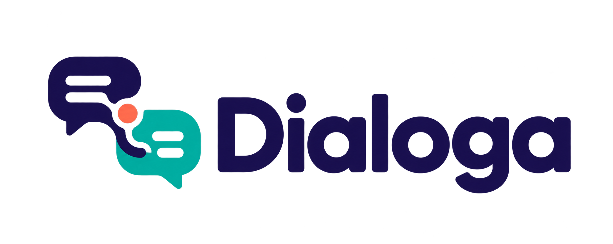

<p align="center">
  
</p>

<h1 align="center">Convierte conversaciones en oportunidades</h1>

<p align="center">
  <strong>DialogaWP</strong> es el constructor visual de chatbots para WordPress que ayuda a captar, calificar y acompañar a tus visitantes con conversaciones útiles.
</p>

<p align="center">
  <a href="#empieza-en-minutos">Empezar</a> · <a href="#lo-que-puedes-crear">Funciones</a> · <a href="#ia-con-control">IA y privacidad</a> · <a href="#desarrollo">Desarrollo</a>
</p>

---

## Tu sitio puede conversar y convertir

Los formularios estáticos piden demasiado antes de ofrecer valor. DialogaWP transforma esa primera interacción en una conversación guiada: responde preguntas, descubre necesidades y captura los datos que importan para tu negocio.

Todo ocurre dentro de WordPress, con un widget preparado para móvil y un builder visual que tu equipo puede usar sin escribir código.

## Lo que puedes crear

| Para tu objetivo | DialogaWP te ayuda a |
| --- | --- |
| Generar más leads | Capturar nombre, correo, teléfono y respuestas dentro de una conversación. |
| Atender preguntas | Crear rutas guiadas o conectar OpenAI y Anthropic para conversaciones abiertas. |
| Calificar contactos | Ramificar el flujo según las respuestas y etiquetar cada oportunidad. |
| Reservar reuniones | Guiar al visitante a la acción correcta con mensajes, redirecciones y cuenta regresiva. |
| Mejorar conversiones | Revisar conversaciones, fuentes, embudos y tasas de conversión desde WordPress. |

## Una experiencia pensada para convertir

### Flujos visuales, sin código

Diseña conversaciones con un canvas de arrastrar y soltar. Combina nodos de mensaje, pregunta, condición, acción, IA y bucle para construir experiencias que se adaptan a cada visitante.

### Captura datos con contexto

Obtén información cuando el visitante está listo para compartirla. Guarda respuestas como variables, etiqueta leads y exporta los contactos a CSV para continuar el trabajo en tu CRM.

### IA que conoce tu negocio

Conecta tu propia clave de OpenAI o Anthropic. DialogaWP puede usar el contenido de tu sitio como base de conocimiento para responder con información relevante sobre tu oferta.

### Decide con datos

Consulta conversaciones, leads, conversiones, páginas de origen y puntos de abandono. Identifica qué preguntas funcionan y dónde ajustar tu flujo.

### Control desde WordPress

Configura horarios, visibilidad, roles, posición y estilo del widget. El asistente de configuración te acompaña para publicar el primer chatbot rápidamente.

## Lo que incluye

- Constructor visual de flujos con nodos de mensaje, pregunta, condición, acción, IA y bucle.
- Chat con IA opcional mediante OpenAI o Anthropic.
- Formularios conversacionales de captura de leads, etiquetas y variables.
- Importación y exportación JSON de uno o varios flujos.
- Analítica de conversaciones, leads y conversiones.
- Historial de conversaciones, filtros y exportación CSV de leads.
- Widget responsive con persistencia de sesión entre páginas.
- Asistente de configuración y administración en español e inglés.
- Configuración accesible, navegación por teclado y soporte para movimiento reducido.

## Empieza en minutos

1. Instala DialogaWP en `wp-content/plugins/dialogawp` y actívalo desde WordPress.
2. Abre **DialogaWP > Setup Wizard** para crear tu primer flujo guiado.
3. Si usarás IA, añade tu propia clave en **DialogaWP > AI Settings**.
4. Activa el flujo y empieza a convertir conversaciones en oportunidades.

## IA con control

Las funciones de IA son opcionales. DialogaWP no realiza llamadas externas si no configuras una clave de proveedor y no utilizas nodos de IA.

Cuando habilitas OpenAI o Anthropic, las solicitudes se envían con la clave que tú proporcionas para responder en un nodo de IA, generar el flujo inicial o crear la base de conocimiento. Revisa las políticas de tu proveedor antes de activar estas funciones y no incluyas claves API ni datos de visitantes en el repositorio.

## Requisitos

- WordPress 6.2 o superior.
- PHP 7.4 o superior.
- Una clave propia de OpenAI o Anthropic solo para las funciones de IA.

## Desarrollo

El canvas se construye con `@xyflow/react` y esbuild. El código fuente está en `src/canvas/` y WordPress proporciona React y ReactDOM mediante sus handles registrados.

```bash
nvm use
npm ci
npm run build
npm test
```

Los archivos generados se escriben en `assets/js/build/`. `package-lock.json` fija las dependencias y `THIRD-PARTY-LICENSES.txt` conserva los avisos de terceros.

Las traducciones administrativas se gestionan desde `languages/*-es.json`:

```bash
node tools/build-translations.cjs
```

## Licencia

DialogaWP se distribuye bajo [GNU GPL v2 o posterior](https://www.gnu.org/licenses/gpl-2.0.html). Se conservan los avisos de autoría y licencia del plugin original.

---

<p align="center">
  <strong>Haz que cada visita tenga una conversación que valga la pena.</strong>
</p>
